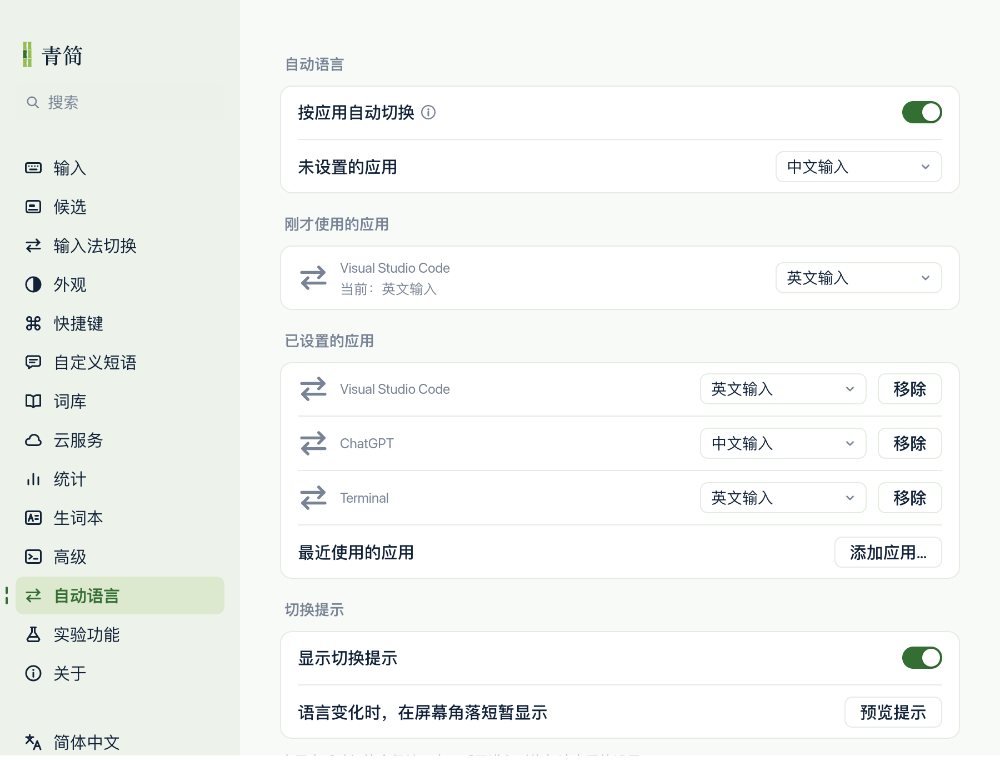

[简体中文](README.md) | **English**

# Qingjian Auto Lang

**Switch Qingjian's input language automatically when you switch apps.**

This is an independent fork of [Qingjian](https://github.com/qingjian-team/qingjian), with application detection and rule handling adapted from [Input Source Pro](https://github.com/runjuu/InputSourcePro). Qingjian remains the active system input source; app rules change its internal input language. For example, use English in VS Code and Terminal, and Chinese in ChatGPT.

## Why this fork exists

Switching between Chinese conversations and English terminal commands often means noticing the wrong input language only after typing the first sentence, deleting it and starting again.

Qingjian already has several input modes. This fork selects one when you enter an app, while keeping manual switching available for occasional exceptions.

## What this fork adds

- **Auto Language settings:** choose an input language for each app from a dropdown. Apps without a rule follow the global default. The macOS version currently supports Chinese, English and Vietnamese input.
- **Recent apps only:** select from the ten most recently used apps, deduplicated and ordered by recency. To configure an app, switch to it and then return to Qingjian settings.
- **Manual switching stays available:** a manual language change lasts for the current app visit. Leaving the app and returning applies its configured language again.
- **Optional language notification:** briefly show the language you switched to, only when it actually changes.
- **One integrated app:** use Qingjian's existing settings and input engine. Input Source Pro's separate app and GUI are not bundled or required.

The automatic switching feature is currently **macOS only**. Rules apply to an entire app: browser tabs, windows and input fields share one rule, as do VS Code's editor and integrated terminal.

## Screenshot



*Settings UI with sample applications and rules.*

## Get started

1. Select Qingjian as the system input source.
2. In **Settings → Input Method Switching**, enable **Chinese/English switching**.
3. Open **Auto Language** and enable automatic app switching.
4. Switch to an app you want to configure, return to settings, and choose its input language in the **Last used app** dropdown. Use **Add app…** to choose another recent app.

Automatic switching is off by default. App rules are saved; the recent-app list is held in memory and starts empty after Qingjian restarts. The input-language choices are separate from Qingjian's candidate gloss and interface languages.

See the [usage guide](docs/user/input/auto-language.md) (Chinese) for details.

## Build and install on macOS

With Rust and Xcode installed:

```sh
git clone https://github.com/bukobyte/qingjian-auto-lang.git
cd qingjian-auto-lang
tools/release/data-fetch.sh
apps/macos/scripts/bundle.sh --install
```

The data download uses the version pinned by this repository. The install command builds the input method and its bundled apps, then installs them under `~/Library/Input Methods/Qingjian.app`.

The [Qingjian website](https://qingjian.app/) and [upstream releases](https://github.com/qingjian-team/qingjian/releases) belong to the original project. They are not the download channel for this fork's Auto Language feature; use a build from this repository.

## Thanks and attribution

- **[Qingjian](https://github.com/qingjian-team/qingjian):** thanks to its original author [@yenharvey](https://github.com/yenharvey), [qingjian-team](https://github.com/qingjian-team) and all contributors for the input engine, dictionaries, settings interface and cross-platform foundation.
- **[Input Source Pro](https://github.com/runjuu/InputSourcePro):** thanks to its author [@runjuu](https://github.com/runjuu) and contributors for application-aware input switching and its open-source implementation.

This fork adapts Input Source Pro's app activation, stable application identification and filtering approaches in Rust. It does not copy the complete Swift application or its interface. See the [source and adaptation record](apps/macos/src/auto_language/SOURCE.md).

## Documentation and feedback

- [Auto Language usage guide](docs/user/input/auto-language.md) (Chinese)
- [Upstream Qingjian documentation](https://qingjian.app/docs)
- [This fork's Issues](https://github.com/bukobyte/qingjian-auto-lang/issues): include the apps involved, the order in which you switched between them, and the expected and actual input languages.

This fork is being refined through daily use. Feedback is welcome.

## License

The repository is licensed under [GPL-3.0-or-later](LICENSE), with additional component and data licenses documented in their respective directories. Project names and logos are not included in the code license. See the [data sources](docs/design/landscape.md) and the preserved [Input Source Pro license](apps/macos/src/auto_language/INPUTSOURCEPRO-LICENSE).
