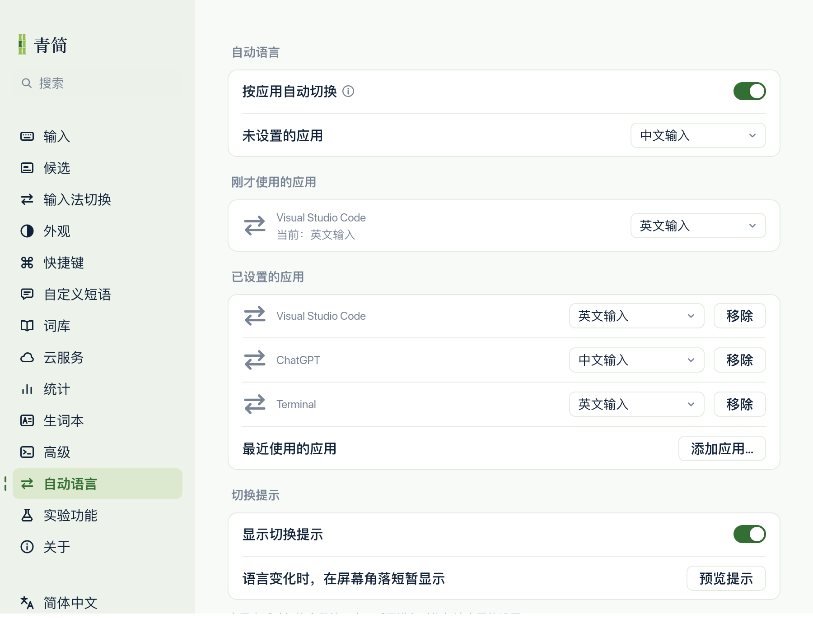

<p align="center"><b>简体中文</b> | <a href="README.en.md">English</a></p>

# Qingjian Auto Lang

**在青简中，按应用自动切换输入语言。**

本项目 fork 自 [青简 Qingjian](https://github.com/qingjian-team/qingjian)，并参考 [InputSourcePro](https://github.com/runjuu/InputSourcePro) 的应用识别和自动切换机制，为青简增加「自动语言」功能。本仓库是独立维护的 fork，不是上游青简的官方发行版。

## 为什么做这个 fork

聊天时想输入中文，切到终端或代码编辑器时想输入英文，却经常输入第一句话后才发现语言不对，只能删除重来。

青简本身已有多种输入模式，因此可以保持系统输入法为青简，切换应用时自动选择青简内部的输入语言。例如：ChatGPT 使用中文，VS Code 和 Terminal 使用英文，偶尔需要其他语言时再手动切换。

## 相比上游新增了什么

- **自动语言设置页**：为每个应用选择进入时使用的语言，未设置的应用跟随全局默认。
- **最近十个应用**：先切到想设置的应用，再回到设置中选择；按最近使用排序、同一应用去重，无需搜索进程或选择文件。
- **统一语言下拉框**：按当前平台可用的输入模式提供选项。目前 macOS 可选中文、英文和越南语；这与候选词的辅助译文语言不同。
- **保留临时手动切换**：在同一应用内手动换语言后，本次使用期间保持；离开后再次进入，恢复该应用的默认语言。
- **可关闭的切换提示**：语言实际变化时，短暂显示「已切换到英文输入」等完整提示。

此功能目前只接入 **macOS**，按应用生效，同一应用的窗口和输入框共用规则，不区分浏览器网页或 VS Code 的编辑区与集成终端。

InputSourcePro 的应用激活、稳定应用标识和过滤处理以 Rust / objc2 重新实现，融入青简现有设置。无需另行运行 InputSourcePro，也不包含它原来的 GUI、菜单栏、窗口或网站规则。

## 界面预览



*设置界面示例，图中的应用和规则为示例数据。*

## 开始使用

1. 将系统输入法选为青简。
2. 在「设置 → 输入法切换」中开启「中英文切换」，再到「自动语言」开启「按应用自动切换」。
3. 切到要配置的应用，再回到设置，在「刚才使用的应用」右侧下拉框选择语言；也可通过「添加应用…」选择最近使用的应用。

自动语言默认关闭。已设置的规则会保存，最近应用列表只保留在本次输入法运行期间，重启后重新积累。完整说明见[自动语言使用文档](docs/user/input/auto-language.md)。

## 从本仓库构建与安装

在 macOS 上准备项目所需的 Rust 和 Xcode 后：

```sh
git clone https://github.com/bukobyte/qingjian-auto-lang.git
cd qingjian-auto-lang
tools/release/data-fetch.sh
apps/macos/scripts/bundle.sh --install
```

构建会安装到当前用户的输入法目录，并保留已有用户配置与学习数据。开发环境和更多构建说明见[开发文档](docs/)与[开发约定](docs/contributing.md)。

[青简官网](https://qingjian.app/download)和[上游 Releases](https://github.com/qingjian-team/qingjian/releases)提供上游版本；要使用本仓库新增的「自动语言」，请使用本仓库构建的版本。

## 致谢

- **[青简 Qingjian](https://github.com/qingjian-team/qingjian)**：感谢原作者 [@yenharvey](https://github.com/yenharvey)、[qingjian-team](https://github.com/qingjian-team) 及所有贡献者。青简的输入引擎、候选界面、词库与设置程序，是本项目的基础。
- **[InputSourcePro](https://github.com/runjuu/InputSourcePro)**：感谢作者 [@runjuu](https://github.com/runjuu) 及所有贡献者。其按应用识别和自动切换的设计与实现，为本项目提供了重要参考。

本项目新增的是青简内部的应用语言自动切换集成，两项上游项目已有的能力归功于各自作者和贡献者。InputSourcePro 的具体参考范围、源文件与许可记录见[参考与移植记录](apps/macos/src/auto_language/SOURCE.md)。

## 文档与反馈

- [自动语言使用说明](docs/user/input/auto-language.md)
- [上游青简使用文档](https://qingjian.app/docs)
- [本项目 Issues](https://github.com/bukobyte/qingjian-auto-lang/issues)：请提供涉及的应用、切换顺序，以及预期和实际的输入语言。

目前处于持续实际使用和迭代阶段，欢迎反馈问题。

## 许可

代码遵循仓库的 [GPL-3.0-or-later](LICENSE) 及各目录中的许可说明，保留上游版权与许可。项目名称与 logo 不包含在代码授权中。随包数据的来源与许可见[数据来源清单](docs/design/landscape.md)。
